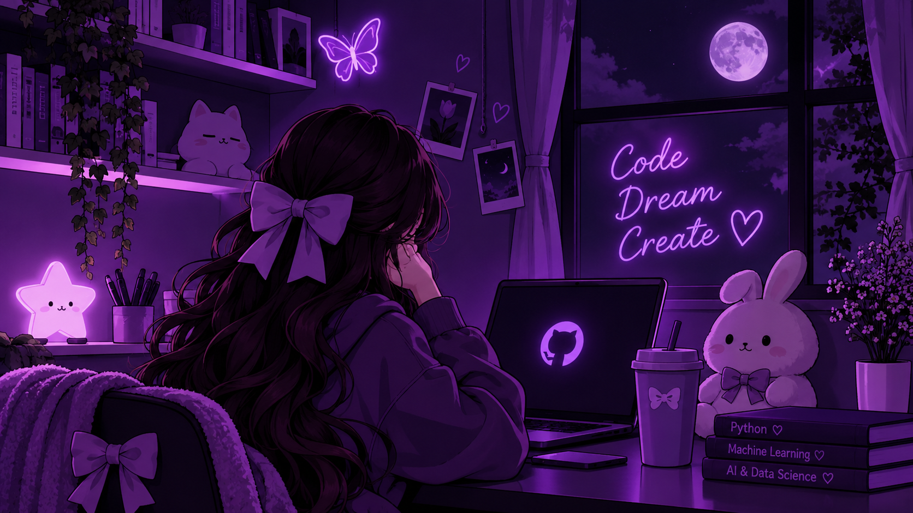

### 🌷 Software Engineer | AI & ML Enthusiast

  
  
  

---

<h2 align="center">🌸 About Me 🌸</h2>

Hi! I'm **Momina Haroon**, a Software Engineering student who loves technology, creativity and innovation.

- 🎓 Software Engineering – Iqra University
- 💗 Interested in Artificial Intelligence and Machine Learning
- 🐍 Exploring Python and Deep Learning
- 🤖 Passionate about LLMs and AI Agents
- 🧠 Interested in Intelligent Automation
- 🌷 Always learning and building new things

---

<h2 align="center">🎀 My Tech Garden 🎀</h2>

### 💻 Programming Languages

### 🦋 Development Tools

### 🌷 AI & Machine Learning

---

<h2 align="center">🦋 My Featured Projects 🦋</h2>

### 🌸 01. Recoverly – AI Lost & Found Platform

An AI-powered platform that helps people find lost belongings using image matching and location-based search.

### 💜 02. NavLab – Robot Navigation & LLM Benchmarking

A project focused on robot navigation and benchmarking open-source LLMs for system-level tasks.

### 🎀 03. AI Agent Projects

Exploring intelligent AI agents that automate tasks using open-source language models.

---

<h2 align="center">🌷 My GitHub Statistics 🌷</h2>

  

  

---

<h2 align="center">🌺 A Little Note From Me 🌺</h2>

### "Bloom with Grace, Code with Passion." 💗

### Dream • Create • Innovate

Thank you for visiting my little corner of GitHub! 🦋

**Made with love by Momina Haroon**

 

<a href="https://github.com/MominaKhan000">GitHub</a>
&nbsp; • &nbsp;
<a href="https://www.linkedin.com/in/momina-haroon-3a406a342">LinkedIn</a>
&nbsp; • &nbsp;
<a href="mailto:haroonmomina09@gmail.com">Email</a>

